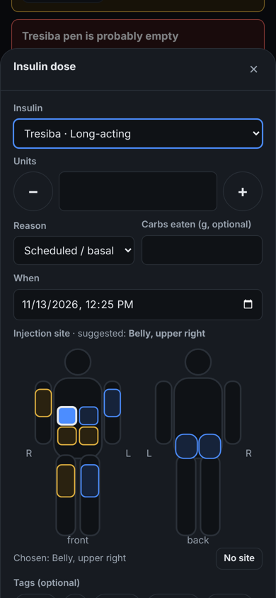
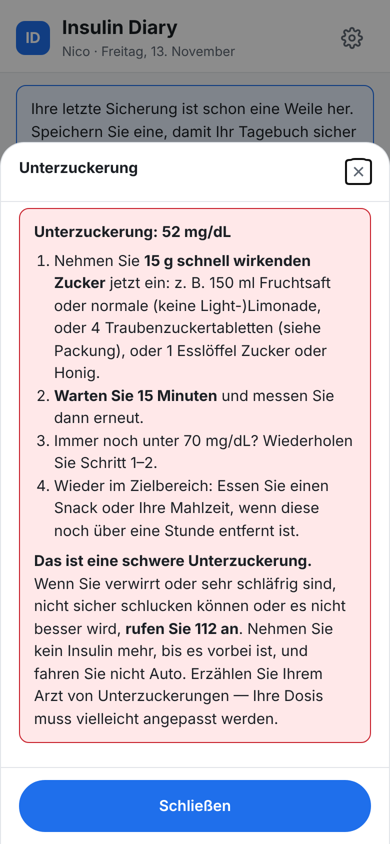
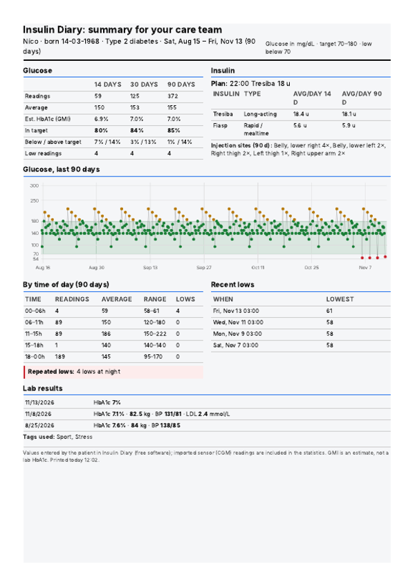
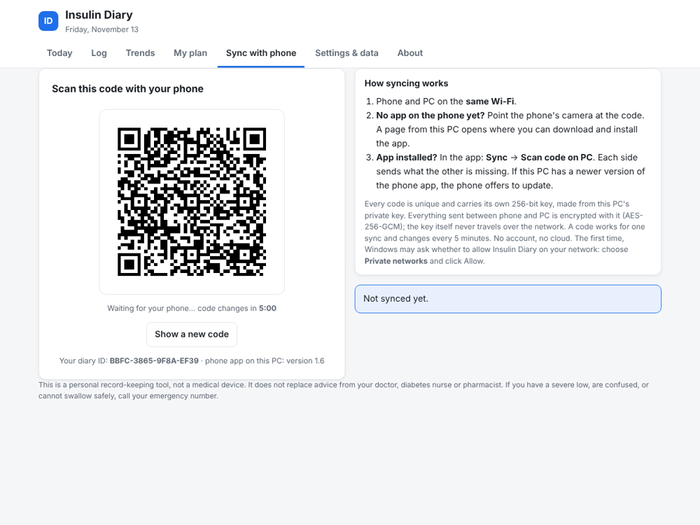

# Insulin Diary Power Control

A free glucose and insulin diary for people with **type 1 or type 2 diabetes**, for **Windows** and **Android**, with private phone ↔ PC sync over your own network (Wi-Fi, hotspot or USB cable). No account, no cloud, no ads, no tracking.

Made by **NeQo**. Public domain ([The Unlicense](UNLICENSE)).

> ⚠️ **Not a medical device.** Insulin Diary is a personal record-keeping tool. It never calculates insulin doses; it records the plan your care team gave you, reminds you, and warns about possible mistakes. Always follow the advice of your doctor, diabetes nurse or pharmacist.

<p>



</p>

## Download

Go to **[Releases](../../releases/latest)**:

- **Insulin Diary Power Control.exe**: Windows 10/11. Run it to install or update (no administrator rights needed). The Android app is included: open **Sync with phone** and point your phone's camera at the QR code to install it.
- **InsulinDiary.apk**: the Android app (8.0 and newer), if you'd rather install it directly.

The files are not signed with a paid certificate, so Windows SmartScreen and Google Play Protect will warn you once. Choose **More info → Run anyway** or **Install anyway**.

## Features

- **Daily log**: glucose, insulin doses, meals and carbs, ketones (blood or urine), lab results; tags such as *sport*, *ill* or *stress*.
- **Safety checks**: double-dose warning, max single dose, plan check, "insulin still active" (anti-stacking), low and high glucose guidance, ketone/DKA guidance for type 1.
- **Alarms**: for every planned dose, glucose-check alarms and a recheck 15 minutes after a low. On Android they ring like an alarm clock, even when the phone is locked or silent.
- **Supplies**: counts down units in your pen or vial; warns before it runs out, when an opened pen passes its use-by period, and when spares run low.
- **Injection-site rotation**: body map with recently used spots and a suggested next spot.
- **Trends**: time in range, estimated HbA1c (GMI), patterns by time of day, low-pattern alerts, tag comparison, lab-result charts, CGM import (LibreView / Dexcom Clarity CSV).
- **Doctor's visit summary**: a one-page, 90-day PDF.
- **Emergency card**: on screen, as a printable wallet card, or on the Android lock screen.
- **Sync**: phone ↔ PC over Wi-Fi, a hotspot or a USB cable, with a network check on both sides; or by file.
- **Your look**: light / dark / follow system, your own accent and background colours, text size 80–150 %.
- **Languages**: English, Nederlands, Français, Deutsch.

## Private sync between phone and PC



The QR code on the PC does two things. Scanned with the **phone's camera**, it opens a download page served by your PC to install the app. Scanned **inside the app**, it syncs both ways and offers app updates carried by the PC.

- Each installation creates its own random **256-bit master key**; its fingerprint is the *diary ID* shown on both devices (the phone warns before syncing with a different diary).
- Every QR code carries a fresh 256-bit key derived from it (HMAC-SHA256). It sits after `#` in the link, which browsers never send, so the key never travels over the network.
- Everything between phone and PC is encrypted and authenticated with **AES-256-GCM**. A code works for one sync and changes every 5 minutes.
- App updates are verified against a SHA-256 hash sent inside the encrypted answer; Android additionally checks the app signature.

**Works on more than one kind of network.** Phone and PC only need to share a network: the same Wi-Fi or router (the PC may be on a cable), the PC's mobile hotspot, the phone's hotspot, or a USB cable with USB tethering on. The QR code lists every usable PC address (VPN and virtual adapters such as VirtualBox or Hyper-V are left out), so the phone tries them all.

- **Network check on the PC**: shows each connection, whether Windows treats it as a *Public* or *Private* network, and whether the Windows firewall lets the phone in. **Fix it** allows Insulin Diary on home networks and can mark your home network as Private (Windows asks for administrator permission once).
- **Network check on the phone**: if the PC can't be reached, the phone says why: on mobile data, on a different Wi-Fi, a VPN is on, or the router keeps devices apart.
- **Reverse connection**: when the firewall blocks the phone, the phone waits and the PC connects to the phone instead (outgoing connections aren't blocked). Same encryption, same one-time code; no administrator rights needed.
- **No shared network at all?** Save a diary file on one device and use **Merge a diary file** on the other; entries from both sides are kept.

## Where data is stored

- Windows: `%LOCALAPPDATA%\InsulinDiary\diary.json`, plus a daily copy for the last 14 days in `backups\`.
- Android: in the app's private storage, with 14 daily copies.
- Backups and CSV export: *Settings & data*.

## Building from source

Requirements: Python 3, Go 1.22+, JDK 17 and the Android SDK (or Android Studio).

```bash
# 1. combine the app page and translations; copies it into windows/ and android/
python3 app/build.py

# 2. Android app (Android Studio: open android/InsulinDiary → Build APK)
cd android/InsulinDiary && ./gradlew assembleRelease && cd ../..
cp android/InsulinDiary/app/build/outputs/apk/release/app-release.apk windows/phone/InsulinDiary.apk
#    (update windows/phone/version.json to the app's versionCode / versionName)

# 3. Windows program (cross-compiles from any OS)
cd windows && GOOS=windows GOARCH=amd64 go build -trimpath -ldflags "-H windowsgui -s -w" -o "Insulin Diary Power Control.exe" .
```

Without a `keystore.properties` file the Android app is signed with your debug key. To publish your own updates, create your own signing key; updates must always be signed with the same key.

Project layout:

| Folder | What it is |
|---|---|
| `app/` | The diary itself (one HTML page shared by Windows and Android) and its translations |
| `windows/` | Windows installer + local server (Go): storage, encrypted sync, install page |
| `android/InsulinDiary/` | Android app (Kotlin): WebView, QR scanner, alarms, lock-screen card, updates |
| `tools/mkres.py` | Generates the Windows icon and version resource |

## Support

Insulin Diary stays free either way. If it helps you, you can [buy NeQo a coffee](https://www.paypal.com/qrcodes/managed/3bc06491-cd2e-4cf0-8409-dce3e26597ed) (minimum €5).

Translations into Dutch, French and German were not reviewed by a medical professional. Corrections from native speakers, especially diabetes nurses, are very welcome.

## License

Public domain: [The Unlicense](UNLICENSE). Third-party parts keep their own licences: the Go standard library (BSD), AndroidX (Apache 2.0) and the Google Play services code scanner (Google's terms).
